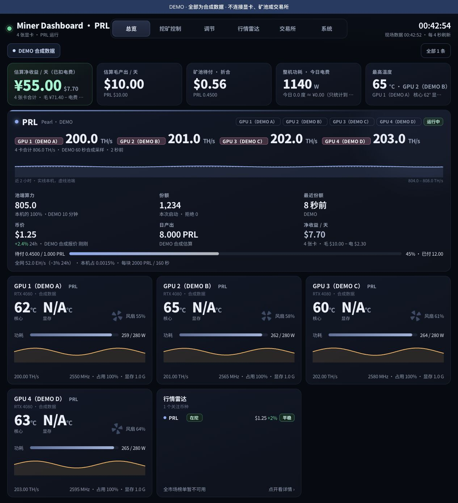
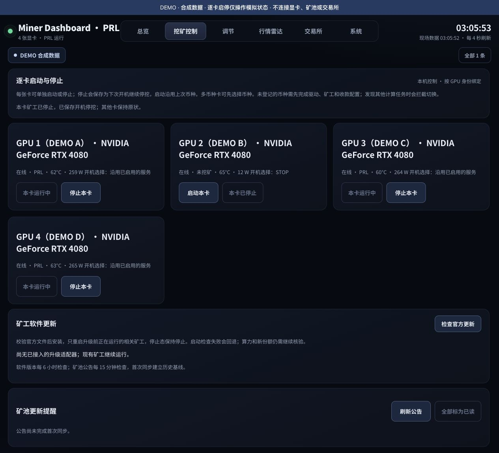
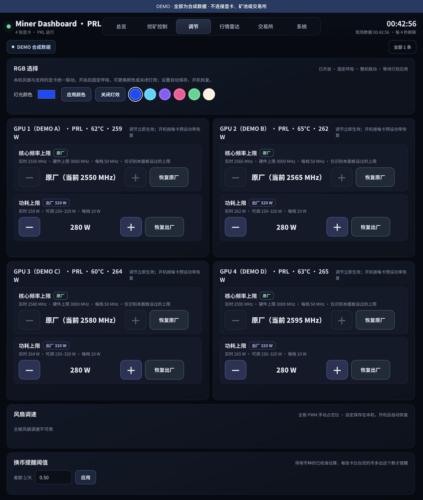
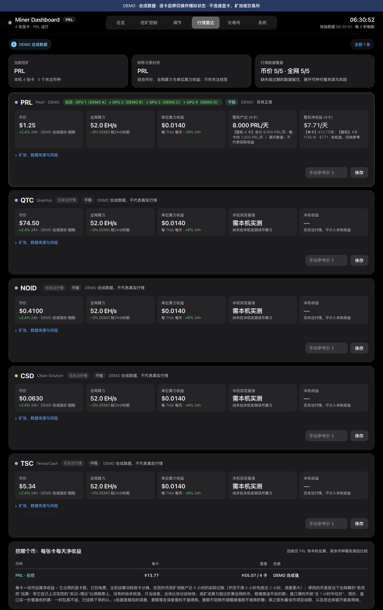

# Miner Dashboard · 矿机监控与管理

把显卡、矿工、功耗、温度、行情和 RGB 放在一个网页里。面向自己管理 Linux / NVIDIA 矿机的人，手机、电脑均可访问。

从真实自用矿机系统整理出的独立开源版。**仓库没有运行中的钱包、交易所密钥、登录密码、私人域名、GPU 身份或收益历史。下图全部由合成 DEMO 数据生成。**

[](https://github.com/sergepoliakov/miner-dashboard/actions/workflows/ci.yml)
[](LICENSE)



## 能做什么

| 功能 | 说明 |
| --- | --- |
| 显卡看板 | 核心温度、显存温度可用性、功耗/上限、风扇、占用、每卡算力和趋势 |
| 矿工管理 | 绑定已安装的 systemd 用户服务；每卡独立启动/停止、记住上次币种、开机选择与冲突检查 |
| 功耗与频率 | 可选 root 助手，经受限 Unix socket 调节；按 UUID 保存和恢复 |
| 行情雷达 | 报价、全网算力/难度、池端与本机数据、估算收益、电费和数据时效 |
| RGB 选择 | 整机选择颜色、开灯/关灯；固定 7.5 秒呼吸，20% 底光；需支持的 OpenRGB 设备 |
| CPU 矿工 | 可选 NOID CPU 服务状态、当前进程采样和 1–12 线程调节 |
| 公告与更新 | 已实现的矿池公告源及按配置启用的矿工更新适配器，校验与失败回退 |
| 远程访问 | 独立账号密码网关、持久会话、Origin/CSRF 校验；放在 HTTPS 代理后 |
| SafeTrade | 可选、隔离凭据的账户适配器；**默认只读，真实账户/下单仍需使用者核验** |

核心与演示只使用 Python 标准库，无前端构建、无 Docker 依赖。RGB 是单独的可选依赖。

## 先看演示，30 秒启动

Python **3.11+**（演示可在 macOS/Linux 运行）：

```bash
git clone https://github.com/sergepoliakov/miner-dashboard.git
cd miner-dashboard
python3 scripts/demo.py
```

打开 **[本机 DEMO](http://127.0.0.1:18091)**。不需要显卡、钱包、交易所账号或管理员权限。DEMO 可点击“启动本卡 / 停止本卡”，只改变隔离的模拟状态；真实硬件、交易和其他写操作均拒绝。退出用 `Ctrl+C`。

## 接到自己的矿机

生产目标是 Linux + systemd + NVIDIA 驱动。先确认 `nvidia-smi` 正常，矿工已从其官方来源安装，并能独立运行、产出有效份额。

```bash
python3 scripts/configure.py init
python3 scripts/configure.py discover
# 仅本机只读启动；没有币种配置也可以看硬件。
MINING_MONITOR_ALLOW_EMPTY_COINS=1 python3 app/mining_monitor.py
```

打开 [本机监控](http://127.0.0.1:8091)。所有私有配置放在 `~/.config/miner-dashboard/`，历史放在 `~/.local/state/miner-dashboard/`，均在 Git 克隆目录之外。

接下来按 [安装与开机恢复](docs/INSTALL.md) 完成：

1. [绑定自己的显卡 UUID、矿工与日志](docs/CONFIGURATION.md)，核对本机/池端算力和有效份额。
2. 安装用户服务，按需开启控制；设置 linger，保证无人登录也启动。
3. 可选安装功耗/RGB/交易所助手。它们分开启用，没有一键全开脚本。
4. [配置账号密码与 HTTPS 远程访问](docs/REMOTE_ACCESS.md)，再做真实重启验收。
5. [绑定 SafeTrade](docs/EXCHANGE.md)。只绑定账户可保持只读，无需开放下单。

**不会自动下载矿工、填写收款地址、开启挖矿、刷 BIOS、更改 PCIe 或给所有显卡套统一瓦数。** 这些决定由部署者自己的硬件与矿工配置负责。显卡功耗上限允许实际功耗低于它，不构成强制恒定功率。

## 界面







页面为简体中文，支持窄屏布局。显卡显示名称与编号通过 UUID 绑定；数字编号与 NVIDIA 临时索引分开。

## 支持范围与已知边界

- 正式部署以 Linux/systemd/NVIDIA 为目标；AMD、Windows 的硬件与服务控制尚未实现。演示不受这个限制。
- 每张卡独立启停需要独立矿工服务。共用一个多卡矿工时，逐卡切换会被拦截，避免误停其他卡；请按[逐卡配置指南](docs/PER_GPU.md)生成独立服务后操作。
- PRL/TSC/NOID/QTC 相关解析与更新适配器保留在源码中；不同矿池字段、日志格式及第三方接口会变，需核对配置。程序运行不等于已接受份额。
- 当前通用版没有启用原部署的固定 NOID GPU API 映射；可用通用 GPU 日志适配器。NOID CPU 支持单独保留。
- NVIDIA 驱动不提供某个传感器时显示 N/A。仓库未分发非官方显存寄存器温度读取程序。
- RGB 原生 MSI 路径仅针对明确匹配的 RTX 4080 GAMING X TRIO PCI 身份，默认关闭；其他设备走 OpenRGB Direct，实物效果需现场核验。见 [RGB](docs/RGB.md)。
- 交易所仅实现 **SafeTrade**，没有 Binance/OKX 绑定。账户端点和真实卖单未通过本项目的真实资金验收；模拟测试不能替代交易所回执。没有提现操作。
- 净收益由行情、产出、费率、电费和主机余耗估算；不代表到账、未来收益或墙上电表实测。默认电价与余耗仅是可修改的示例参数。
- 断电来电自动开机由主板 BIOS/UEFI 负责；外网恢复依赖网络、DNS、TLS/隧道和 SSH 配置。仓库不会承诺所有硬件/网络无需维护。

## 文档与开发

- [每张卡启动/停止与共享矿工迁移](docs/PER_GPU.md)
- [安装 / 升级 / 卸载 / 重启验收](docs/INSTALL.md)
- [配置、日志解析、GPU 固定顺序和矿池收款](docs/CONFIGURATION.md)
- [远程 HTTPS 与 SSH](docs/REMOTE_ACCESS.md)
- [SafeTrade 账户绑定与交易边界](docs/EXCHANGE.md)
- [RGB 支持与硬件配置](docs/RGB.md)
- [架构与排错](docs/ARCHITECTURE.md)
- [安全与脱敏](SECURITY.md) · [贡献指南](CONTRIBUTING.md) · [第三方说明](THIRD_PARTY.md)

```bash
PYTHONPATH=app python3 -m unittest discover -s tests -v
python3 scripts/check_privacy.py
python3 -m compileall -q app scripts
```

测试使用合成身份和模拟传输，不连接生产矿机，不发出真实订单。提交 issue 时不要上传原始配置、钱包、账户、隧道、日志或完整 GPU 身份。

## English quick start

A self-hosted Linux/NVIDIA mining dashboard with per-GPU telemetry, systemd miner control, optional power/clock restoration, a market radar, fixed-phase RGB color control, and a password-authenticated HTTPS gateway. Run `python3 scripts/demo.py` for an entirely synthetic, loopback-only demo with no dependencies beyond Python 3.11+. Per-GPU start/stop buttons alter simulated state only. See the Chinese deployment guides above. SafeTrade is optional and read-only by default; live trading is unverified. No miners, wallets, credentials, or private deployment history are bundled.

## 许可证

[GNU GPL v3.0](LICENSE)，见 [第三方来源与分发边界](THIRD_PARTY.md)。矿工、NVIDIA 驱动、OpenRGB 等独立项目遵循各自许可证。仓库不附带它们的二进制。
