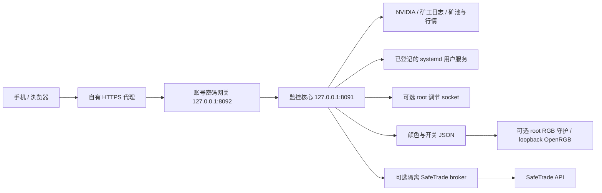

# 架构与排错

核心 Python标准库，前端单HTML（内联CSS/JS，无CDN脚本/外部字体），默认4秒轮询状态、60秒图表、10秒控制状态。遥测不会运行 GPU 绘图任务；采样/日志解析与行情查询仍有CPU/网络开销，具体对算力影响要在自己的硬件实测，不承诺绝对零开销。

## 状态不可混淆

1. GPU被枚举 ≠ 矿工正在计算。
2. 矿工运行 ≠ 新有效份额被矿池接受。
3. 矿池credit/待付 ≠ 交易所充值/链上到账。
4. 网页保存瓦数 ≠ readback已生效；上限 ≠ 固定实际耗电。
5. OpenRGB缓存/帧ACK ≠ 实物灯光正确。
6. 服务enabled ≠ 已在真实重启后恢复。

## 常见问题

| 现象 | 按顺序检查 |
| --- | --- |
| 网页没数据 | 核心进程、127.0.0.1:8091/api/status、当前采样时间、NVIDIA驱动、日志路径/权限/正则 |
| 外网不可用 | 本地核心 → 本地网关 → HTTPS代理 → DNS/TLS/隧道；不要直接公开8091 |
| 反复要登录 | HTTPS/cookie域名/Host是否一致、session数据库是否可写且持久、是否换了session_key |
| 控制403 | 默认只读开关、登录、同UID、Origin和CSRF；不通过放宽鉴权修复 |
| 卡号错位 | 当前UUID与PCI、gpu-display、矿工CUDA可见顺序、日志gpu_map/gpu_indices分别核对 |
| 瓦数低于上限 | 同时采实际功耗、enforced limit、频率、利用率、降频原因、核心/显存温度、同算法算力 |
| 关机等矿工 | systemd KillMode、TimeoutStopSec、子进程cgroup、驱动是否有D状态；强断电不当作常规关机方法 |
| 显存N/A | NVIDIA官方接口无读数时是预期；仓库未捆绑裸寄存器温度读取程序 |
| 收益暂缺 | 报价/账户/网络字段和时效；单位不匹配或数据不足不编造0收益 |
| RGB静态/不同步 | 实物型号、Direct支持、root配置、I2C归属；只对精确支持型号启用原生路径 |

功耗/温度诊断应记录连续样本并控制变量。先看是否thermal slowdown/power brake，再对照相同驱动下不同负载；小幅瓦数浮动或负载吃不满上限不能独立证明坏卡。接口过热先停止相关卡并由操作者断电核对线材/接头，软件不能修复高阻接触。

日志位置：user `journalctl --user -u miner-dashboard.service`；root助手对应 `journalctl -u ...`。发布日志前删钱包、cookie、账号、完整UUID、真实域名/IP及文件路径，最好提供合成最小复现。
