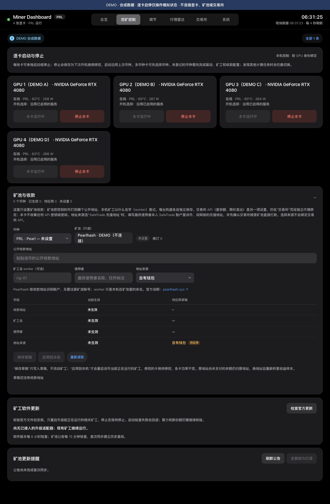

# 钱包地址与矿工身份

“挖矿控制 → 矿池与收款”按本机、按币种管理公开收款地址、worker、使用者和地址来源。PRL、QTC、NOID、CSD、TSC 都可保存草稿；实际应用需要维护者先登记本机矿工适配器。它不会安装矿工、创建钱包或代办交易所开户。



## 使用方法

1. 选择币种，填写自己持有的公开收款地址。钱包私钥、助记词、交易所密码和 API secret 均不填在这里。
2. worker 是本机名称，可留空；例如 `rig-01`。当前 [Pearlhash 官方连接说明](https://pearlhash.xyz/)以 PRL 地址识别矿工账户，worker 可选，无单独注册矿池账号的步骤。
3. 先点“保存草稿”。当前矿工及收款配置保持不变，页面同时显示当前生效与草稿。
4. 核对币种、网络、完整地址和收款人后，点“应用到本机”，在对话框中再次核对目标。此操作只重启该币原本在运行的矿工；已停挖的卡保持停止，开机启停选择和功率不变。其他币种服务不重启。
5. 核对新鲜算力、有效份额和矿池中**新地址**的 worker。显示“服务已启动”还需要这一步验收。

草稿保存到私有 state 目录，重启后仍可读取。真实应用写入维护者登记的矿工 JSON 源配置；原 systemd 启动命令继续读取这些文件。新地址不会把旧地址尚未达到付款门槛的余额转走。账户缓存按地址失效，收益样本按来源隔离，旧历史保留。

多人同时打开面板时，版本和源文件检查会阻止过期页面覆盖新设置。改用另一个币种时，未保存输入不会被轮询覆盖。

## 使用 SafeTrade 充值地址

收款人自己在 SafeTrade 完成开户/验证，在官方页面取得对应币种和网络的充值地址。先核对是否开放充值、是否接受矿池直接付款、最低充值及是否需要 Memo/Tag。当前表单不支持额外 Memo/Tag 字段；需要该字段的充值渠道不能直接用此表单应用。

选择“SafeTrade 充值地址”仅标注地址来源。查看交易所余额和卖出使用独立的 [SafeTrade API 绑定](EXCHANGE.md)；本面板不会因此继承另一位使用者的账户、密钥或余额。把矿机交给他人时，也要由他按该文档绑定自己的账户。

PRL 原生地址检查包含 `prl1` 前缀与 Bech32/Bech32m 校验和。其他币种默认只做基础输入格式检查；维护者可登记 `address_regex`。格式通过不能证明地址归属、网络正确或交易所接受付款。

## 维护者：登记真实矿工

私有适配器默认放在 `$MINER_DASHBOARD_CONFIG/mining-profiles.json`（未设置变量时为 XDG 配置目录下的 `miner-dashboard/mining-profiles.json`），也可用 `MINING_PAYOUT_CONFIG` 指定绝对路径。registry、矿工源 JSON、state 都须由监控用户持有，文件权限600；不要存进 Git。

下面是**结构示例**。先用当前矿工的真实 schema、服务名和路径替换，再填写；示例路径不对应正在运行的矿机。矿工必须本来就会读取该 JSON，单独创建一个 wallet JSON 不会自动改变矿工。

```json
{
  "providers": {
    "PRL": {
      "name": "Pearl",
      "pool": "pool.pearlhash.xyz:9000",
      "services": ["example-prl-gpu0.service", "example-prl-gpu1.service"],
      "files": [{
        "path": "/var/lib/miner-example/prl.json",
        "fields": [
          {"path": ["wallet"], "template": "{address}"},
          {"path": ["worker"], "template": "{worker}"}
        ]
      }]
    }
  }
}
```

- `services` 必须完整匹配 rig-control 中该币种的 GPU profiles；不能指向别的币或任意系统服务。CPU 服务还需出现在 rig-control 的 `cpu_services` 及同币监控配置的 CPU `service` 中。
- 字段只允许钱包/worker 字符串，或 `argv` 数组中已验证钱包/worker 参数后的值。例如原参数为 `--user ADDRESS.WORKER`，可用 `path:["argv",6]`、`template:"{mining_user}"`，前一个元素必须确为 `--user`。不得登记可执行文件、算法、矿池密码、功率或任意命令。浏览器不能提交路径和服务名。
- 模板限定 `{address}`、`{worker}`、`{mining_user}`，后者拼接 `address.worker`，worker 留空时只有地址。只为支持此语法的矿工/矿池使用它。
- `initial` 可填四字段 `address/worker/owner_label/exchange`，须与源文件一致，用于显示首次接管时的当前配置。不填时显示尚未确认生效，不能凭猜测展示当前收款人。
- 可用 `external_locks` 登记矿工配置维护工具共用的绝对锁路径，避免它们同时修改源文件。
- 若监控配置有 `earnings/account/daily` 账户接口，必须用 `{address}` URL，并把 `address_source.file/json_path` 指向上述同一字段。`{mining_user}` 源需配置 `split:"."`。固定旧地址统计会阻止应用，避免新矿工继续显示旧钱包余额。

例如统计的地址来源片段（合并进原币种配置，不要覆盖其余字段）：

```json
{
  "address_source": {"file": "/var/lib/miner-example/prl.json", "json_path": "wallet"},
  "earnings": {"url": "https://pool.example/api/earnings/{address}"}
}
```

`pool.example` 仅示意动态地址写法，不是可用 API；实际解析字段和接口以矿池官方文档及本项目对应解析器为准。未登记的币种只存草稿，界面不会假装已经安装或已经切换。

核心仍默认只读；实际写操作需 `MINER_DASHBOARD_CONTROLS=1`，并经过现有同 UID / Origin / CSRF 校验。公网由原账号密码网关转发，只有登录后可使用。

## 失败与恢复

应用异常会尝试恢复本次写入与原运行选择。若浏览器或代理先超时，结果可能尚未确定；先重新读取配置并核对服务，勿直接重复应用。若其他程序在应用后改了同一源文件，回退会保留那次独立修改、停止自动重启并报告“回退不完整”，避免覆盖；现场应核对源文件和实际进程。

事务执行中会在私有 `mining-profiles/recovery-币种/` 保存600备份和清单。成功或完整回退后清理；进程被杀、断电或回退未完成时保留，并阻止再次应用。它不宣称多文件写入具备断电原子性：维护者须按清单核对各源文件、恢复目标版本及原活跃服务，确认后清理该恢复目录。测试环境先验证服务启动、份额及重启后的收款地址，再用于真实资金。
